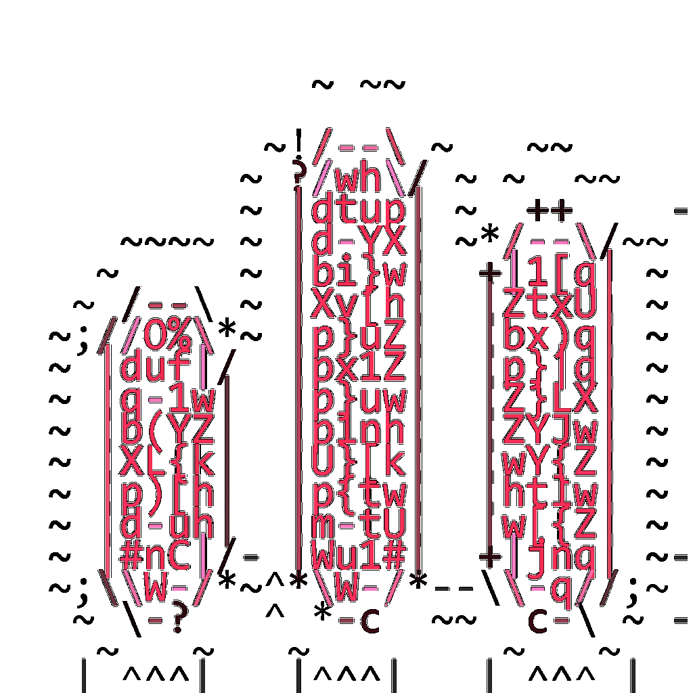

<p align="center">
  
</p>

<h1 align="center">Peak &amp; Peak Studio</h1>

<p align="center"><strong>Slow it down. Give it space.</strong></p>

<p align="center">
  <a href="#use-the-studio"></a>
  <a href="package.json"></a>
  <a href="src/lib/audio/engine.ts"></a>
</p>

<p align="center">
  <a href="#run-locally"><strong>Run the studio →</strong></a> &nbsp; · &nbsp;
  <a href="#use-the-studio">How it works</a> &nbsp; · &nbsp;
  <a href="https://github.com/Hot-Sweeper/peak-and-peak-studio/issues">Feedback</a>
</p>

---

A **stable** browser audio studio for when a perfectly good song clearly needs to be slower and sound like it's playing in a parking garage. Load a track, adjust reverb, bass, or pitch, and export a WAV. Processing happens on your device. Your tracks only leave it when you choose to transfer your library to another device.

## Highlights

- Slowed playback and reverb controls
- Bass boost and pitch controls
- Waveform visualization and playback controls
- A local track library backed by IndexedDB
- Library transfer: move every song and playlist to another phone with a short code, link, or QR code
- WAV export using browser audio processing
- No account required

## Use the studio

1. Open the app and go to `/studio`.
2. Choose an audio file your browser can decode.
3. Adjust speed, reverb, bass boost, and pitch.
4. Play your track, then use **Export Master** to save a WAV file.

Your browser's audio support determines which file formats it can open. The library is stored locally in that browser; clearing site data removes the stored library.

## Move your library to another device

1. On the device with your songs, tap **Transfer**, then **Share library**. Peak shows a code like `K7MQ-2P9X`, a QR code, and a link, and starts uploading.
2. On the other device, open Peak, tap **Transfer → Receive** and enter the code. Scanning the QR code or opening the link works too.
3. Songs download as soon as they arrive on the server, so the second device can start before the upload finishes. Songs you already have are skipped, and playlists come along.

Keep Peak open on both screens while it runs. If the connection drops, tap **Resume upload** or **Try again** and it continues where it stopped. The code stops working after 7 days or when you tap **Stop sharing**, which deletes the songs from the server.

On iPhone, a Peak icon on the home screen keeps its own storage, separate from Safari. Type the code inside the home screen app instead of opening the link in Safari, so the songs land in the app you actually use.

## Run locally

Requirements: Node.js 20.9 or newer, npm, and Git.

```bash
git clone https://github.com/Hot-Sweeper/peak-and-peak-studio.git
cd peak-and-peak-studio
npm ci
npm run dev
```

Open [localhost:3000](http://localhost:3000), then choose **Open Studio**.

## Production build

```bash
npm run build
npm start
```

The repository includes Railway configuration for building and running the app. No API keys or secrets are needed.

Library transfers store songs on the server's disk for up to 7 days. On Railway, attach a volume to the service (any mount path): Peak picks it up through `RAILWAY_VOLUME_MOUNT_PATH`, and shared libraries then survive redeploys. Without a volume, transfers still work, but a redeploy clears any library that is still being shared. See `.env.example` for size limits.

## Stack

TypeScript · React · Next.js · Tailwind CSS · Web Audio API · Zustand · IndexedDB

## Project structure

```text
src/app/           Landing page and studio
src/components/    Audio controls, waveform, library, and layout
src/lib/audio/     Playback, effects, and background audio
src/lib/db/        Local library storage
src/lib/share/     Library transfer: codes and server-side storage
src/app/api/share/ Transfer API (create, upload, download, stop)
src/stores/        Audio, library, and transfer state
```

## Feedback

Report bugs or suggest improvements through [GitHub Issues](https://github.com/Hot-Sweeper/peak-and-peak-studio/issues). Include your browser, operating system, and steps to reproduce the issue.

---

<p align="center"><sub>Built by <a href="https://github.com/Hot-Sweeper">Mr. Lemon</a> · <a href="https://github.com/Hot-Sweeper/still-browser">Still Browser: experimental alpha</a></sub></p>
